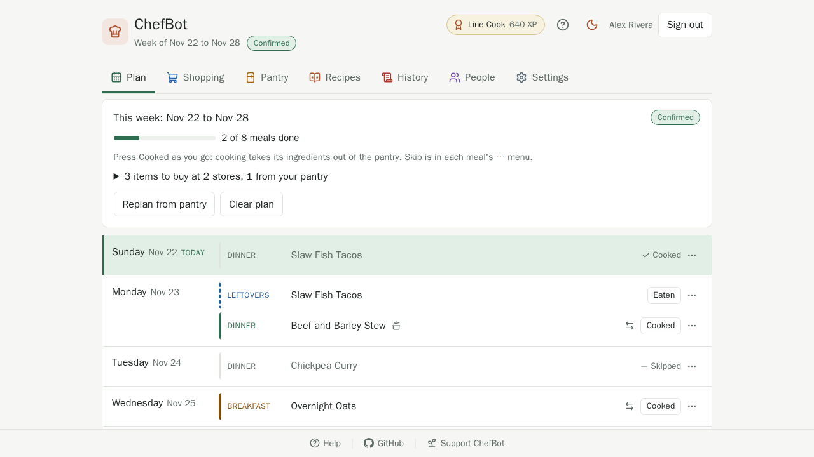
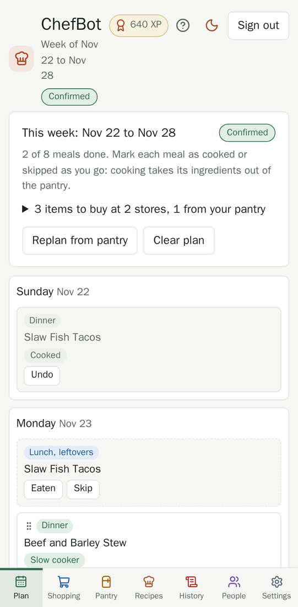
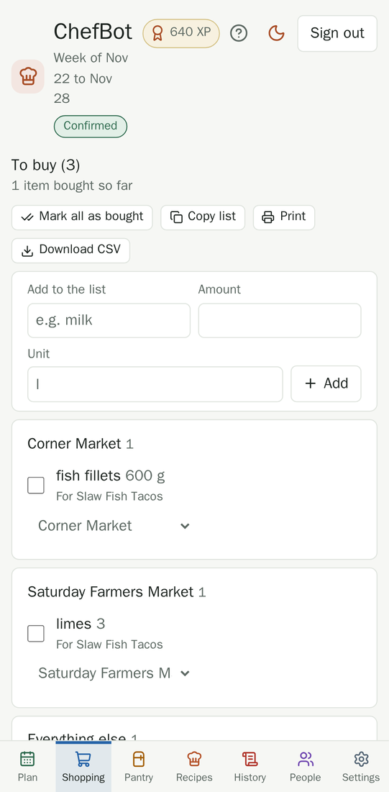
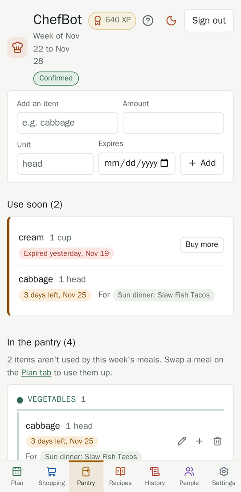
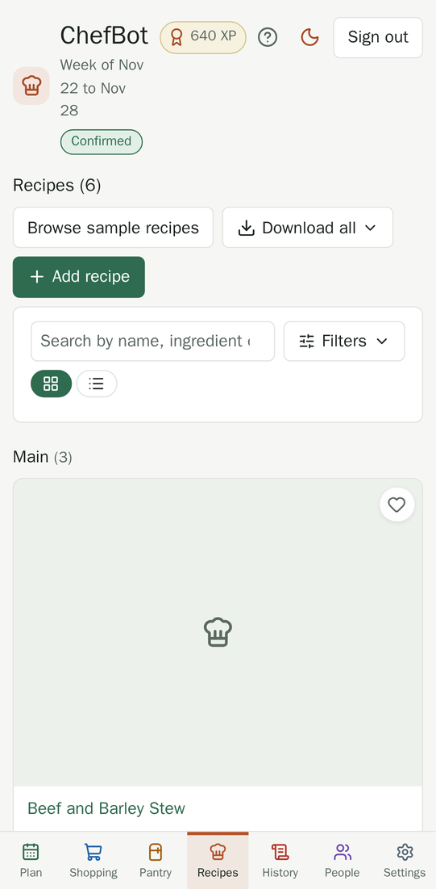

<div align="center">

# ChefBot

**The self-hosted meal planner that turns your pantry into a week of meals, and your week of meals into a shopping list.**

Weekly meal planning, a smart grocery list and a pantry tracker that helps you waste less food.
Runs on your own server with Docker or Podman. Free and open source.

[](LICENSE)
[](https://github.com/Jamiethenextkevinbaconhamm/chef-bot/releases)
[](https://github.com/Jamiethenextkevinbaconhamm/chef-bot/pkgs/container/chef-bot)
[](https://jamiethenextkevinbaconhamm.github.io/chef-bot/)
[](https://buymeacoffee.com/strifer.btw)

[**Get started**](#get-started-in-two-minutes) · [**Features**](#features) · [**Documentation**](docs/index.md) · [**Screenshots**](#screenshots)

<picture>
  <source media="(prefers-color-scheme: dark)" srcset="docs/images/plan-desktop-dark.png">
  
</picture>

</div>

## Plan. Shop. Cook. Waste less.

- **Plan:** a whole week of meals in seconds, in the style your household likes, built around what's already in your
  fridge.
- **Shop:** one shopping list, added up, scaled to the people eating, split by store, and usable with no signal in
  the shop.
- **Cook:** step-by-step cooking mode with big text and timers. Mark it cooked and the pantry updates by itself.

## Why ChefBot

**Stop throwing food away.** Most meal planners pick recipes one at a time. ChefBot plans the *whole week together*,
so the other half of that bunch of coriander goes into Thursday's dinner, and the chicken about to expire comes first.

**Dinner is decided before the week starts.** ChefBot plans next week on Saturday morning (or whenever you like) and
can send you a notification. Review it, swap anything, confirm.

**The shopping list writes itself.** Quantities are totalled and scaled, staples and what you already have are left
off, and the list is split between the stores you use.

**Plans change? So does the list.** Swap a meal mid-week and ChefBot suggests recipes that use what you have. The
leftovers and the shopping list update to match.

**Your kitchen, your server.** No account to make, no subscription, no ads, no tracking. Your recipes and your
household's habits stay on your hardware.

## Features

| | |
|---|---|
| 🗓️ **Weekly meal plans** | Plan styles set your cooking days, leftover lunches, breakfasts, snacks, sweets and drinks, with rules like "at least 2 dinners under 30 minutes" or "no beef". [Plan styles →](docs/using/plan-styles.md) |
| 🥬 **Less food waste** | Plans share fresh ingredients, favour what's in season, and use pantry food that's about to expire first. [How planning works →](docs/developers/planner.md) |
| 🛒 **Smart shopping list** | Totalled, scaled, split by store, sendable to Home Assistant or Todoist, and it works offline. [The shopping list →](docs/using/shopping-list.md) |
| 🥫 **Pantry tracker** | Bought items go in with expiry dates. Cooking takes them out. Swaps that use up food come first. [The pantry →](docs/using/pantry.md) |
| 📖 **Recipe manager** | Paste a link from almost any recipe site, import a Mealie backup, or type it in. Photos, tags, reviews and favourites. Scale any recipe to the servings you need and add it straight to your plan. [Recipes →](docs/using/recipes.md) |
| 👩‍🍳 **Cooking mode** | Big text, one step at a time, what to start early, and timers that ring. [Cooking mode →](docs/using/cooking-mode.md) |
| 📅 **Calendar feed** | Your meal plan in Apple Calendar, Google Calendar, Outlook or Thunderbird, with slow cooker reminders. [Calendar →](docs/using/calendar.md) |
| 🔔 **Reminders** | Plan ready, start the slow cooker, food to use soon, shopping to do: sent to Home Assistant or any webhook. [Notifications →](docs/admin/notifications.md) |
| 🤖 **AI assistant ready** | Read a recipe from a photo of a cookbook page or card, and have gaps in your recipes filled in for you to check, with Claude, OpenAI or a local model such as Ollama. A built-in MCP server lets Claude and other assistants plan your week and manage your pantry. [AI assistants →](docs/admin/ai-assistants.md) |
| 👪 **For one or for many** | Each person signs in, everyone shares the kitchen. Works just as well for a household of one. [People →](docs/admin/people-and-accounts.md) |
| 💾 **Backs itself up** | Nightly backups with one-click restore. [Backups →](docs/admin/backups-and-restore.md) |
| 🔒 **Secure by default** | HTTPS out of the box, account lockout, and a strict browser security policy. [HTTPS →](docs/admin/https-and-certificates.md) |

## Works with

**Mealie** (import your backup with photos) · **Home Assistant** (reminders, to-do lists, calendar) · **Todoist** ·
**Apple Calendar, Google Calendar, Outlook, Thunderbird** · **Claude and other MCP assistants** · any recipe site that
publishes schema.org data · **Docker, Podman, Synology, Unraid, TrueNAS, Portainer, Raspberry Pi**

## Get started in two minutes

**Docker Compose** (Linux, Windows, macOS, NAS):

```sh
curl -O https://raw.githubusercontent.com/Jamiethenextkevinbaconhamm/chef-bot/main/deploy/compose/compose.yaml
# set a password and your time zone in compose.yaml, then:
docker compose up -d
```

**Podman** (Fedora, Bazzite and other Linux with systemd):

```sh
git clone https://github.com/Jamiethenextkevinbaconhamm/chef-bot.git && cd chef-bot
deploy/podman/install.sh
```

Then open `http://<your server>:8080` and follow the setup wizard.
[Full install guides →](docs/getting-started/requirements.md)

## Documentation

Everything you need to run ChefBot is in [the documentation](docs/index.md). It's plain Markdown that you can read
here, on the [documentation site](https://jamiethenextkevinbaconhamm.github.io/chef-bot/), or inside ChefBot itself
by pressing **?**.

| I want to… | Start here |
|---|---|
| Install ChefBot | [Requirements](docs/getting-started/requirements.md) · [Podman](docs/getting-started/install-podman.md) · [Docker Compose](docs/getting-started/install-docker-compose.md) · [NAS and others](docs/getting-started/install-other-platforms.md) |
| Learn to use it | [First run](docs/getting-started/first-run.md) · [The weekly routine](docs/using/weekly-routine.md) |
| Run it for my household | [Settings](docs/admin/settings.md) · [HTTPS](docs/admin/https-and-certificates.md) · [Backups](docs/admin/backups-and-restore.md) · [Upgrading](docs/admin/upgrading.md) |
| Fix a problem | [Troubleshooting](docs/troubleshooting/index.md) · [FAQ](docs/reference/faq.md) |
| Automate it | [HTTP API](docs/reference/api.md) · [MCP for AI assistants](docs/admin/ai-assistants.md) |
| Build on it | [Developer guide](docs/developers/index.md) · [Contributing](CONTRIBUTING.md) |

## Screenshots

| Plan | Shopping | Pantry | Recipes |
|---|---|---|---|
|  |  |  |  |

## Your data stays yours

ChefBot has no cloud service, no telemetry and no accounts outside your server. It only goes out to the internet to
fetch a recipe page you ask for and its photos, and to reach the webhook, to-do app or calendar app you set up. See
[Limits worth knowing](docs/reference/limits.md).

## Support and contributing

- **Questions or problems?** Start with [Troubleshooting](docs/troubleshooting/index.md), then
  [open an issue](https://github.com/Jamiethenextkevinbaconhamm/chef-bot/issues/new/choose). See [SUPPORT.md](SUPPORT.md).
- **Security issue?** Report it privately, as [SECURITY.md](SECURITY.md) describes.
- **Want to help?** Read [CONTRIBUTING.md](CONTRIBUTING.md) and the [developer guide](docs/developers/index.md).
  Better ingredient seasons for your region and readers for new recipe sites are especially welcome.
- **Enjoying ChefBot?** Star the repository, tell a friend, or [buy me a coffee](https://buymeacoffee.com/strifer.btw).

## License

[GNU General Public License v3.0](LICENSE).
