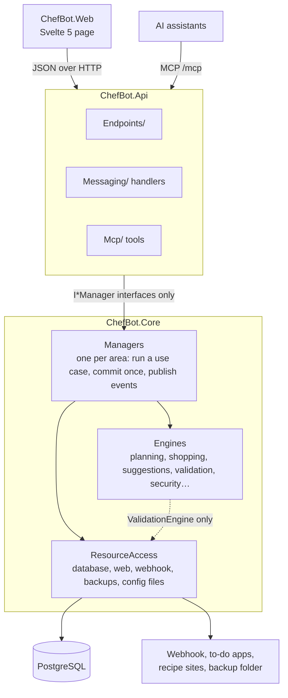

# Architecture

ChefBot is three projects and a database. The core is split into layers by what changes for different reasons, and
calls only go down.

## The projects

| Project | Holds |
|---|---|
| `ChefBot.Core` | Everything below the API. Only `Managers/Contracts/` and `CoreRegistration` are public |
| `ChefBot.Api` | The core's clients: HTTP endpoints, message handlers, MCP tools, sign-in, HTTPS, live updates. Serves the web page |
| `ChefBot.Web` | The web page, a thin client over the API |

## The layers in the core

The design follows *volatility-based decomposition*: each layer hides a different kind of change.

- **Managers** (`PlanManager`, `PantryManager`, `RecipeManager`, `AccountManager`, `MaintenanceManager`) hide
  *how a use case runs*: they load through accessors, hand data to engines, save, commit once and publish events.
- **Engines** hide *how the work is done*: choosing a week, building a shopping list, ranking swaps, reading recipe
  files and pages, checking rules. They take everything as arguments, so they test without a database.
- **Resource accessors** hide *where things live*: PostgreSQL through EF Core, the web, the webhook, the backup folder,
  the JSON catalogs. They take and return plain contracts, never EF entities.
- **Utilities** (ingredient catalog, units, text, clock) can be used by any layer.

Rules that keep it this way:

- Calls only go down. No manager calls a manager, no engine calls an engine, and only `ValidationEngine` among engines
  reads through accessors. [`ArchitectureTests`](https://github.com/Jamiethenextkevinbaconhamm/chef-bot/blob/main/tests/ChefBot.Core.Tests/ArchitectureTests.cs) fails the build
  when a call goes the wrong way.
- Managers that need to react to each other do it with [messages](messaging-and-scheduling.md), never direct calls.
- One way to do each thing: ingredient needs come only from `MealRequirements`, and every plan change goes through
  `PlanManager`, which ends with `ReconcileAsync`. See [The planner](planner.md).

Each layer keeps the types its callers use in its own `Contracts/` folder: `Contracts/Services/` for interfaces and
`Contracts/Messages/` for the records passed through them. The records in `Managers/Contracts/Messages/` are the HTTP
JSON bodies, so their shapes are kept stable.

[Where things go](https://github.com/Jamiethenextkevinbaconhamm/chef-bot/blob/main/CONTRIBUTING.md#where-things-go) in CONTRIBUTING.md has the full table.

## Why one process

Some state lives in memory in the one ChefBot process: the plan write lock, the live update stream and the HTTPS
policy. That's fine for one ChefBot per database, which is what a household needs. Running two would need a PostgreSQL
advisory lock, LISTEN/NOTIFY and a broadcast respectively.

## Size

No source file is over 400 lines (`FileSizeTests`). Big classes are split by area into partial files such as
`PlanManager.Shopping.cs`, so a change usually means opening one small file.
