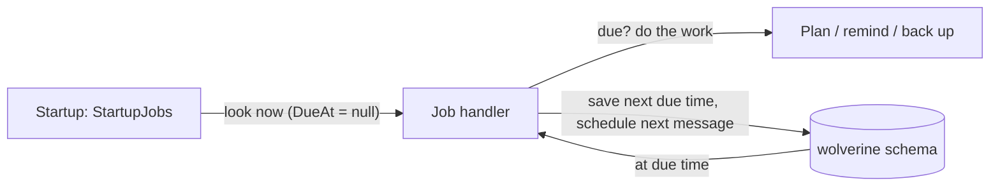

# Messaging and scheduling

Areas of ChefBot react to each other through messages, never direct calls. This keeps managers independent, and it
means slow or failing outside services (a webhook, a photo site) never hold up a request.

## Events and commands

- **Events** say something already happened: `MealCooked`, `RecipesAdded`, `PantryChanged`, `PlanStaged`. Each
  subscriber handles an event on its own, so one event with three handlers is handled three times.
- **Commands** ask for one thing to be done: `FetchRecipeImages`, `CheckWeeklySchedule`, `SuggestRecipeDetails`.

Records live in `Managers/Contracts/Messages/`, each with `[MessageIdentity("chefbot.<name>.v1")]` and a line in
`ContractJsonContext`. They're stored, so their shapes are a contract: they only gain fields, and a breaking change
gets a `.v2` identity.

## Who listens

| Handler | Reacts to | Does |
|---|---|---|
| `PantryChangedHandler` | `PantryChanged` | Rebuilds the open plans' shopping lists after a hand edit to the pantry |
| `MealAddedHandler` | `MealAdded` | Brings a plan's leftover lunches and shopping list in line after a recipe is added from its page (`IPlanManager.CatchUpAsync`) |
| `PlanningSettingsChangedHandler` | `PlanningSettingsChanged` | Rebuilds open shopping lists after the advanced settings change |
| `SecuritySettingsChangedHandler` | `SecuritySettingsChanged` | Applies a changed "Always use HTTPS" to the running server |
| `RefreshIngredientNamesHandler` | `RefreshIngredientNames`, at startup | Files saved recipes' ingredients under the ingredient catalog's current names (`IRecipeManager.RefreshIngredientNamesAsync`); a second run changes nothing |
| `IngredientNamesChangedHandler` | `IngredientNamesChanged` | Rebuilds the open plans' shopping lists after recipes' ingredients were filed under new names |
| `GroceryStoresChangedHandler` | `GroceryStoresChanged` | Re-splits open shopping lists between stores |
| `CookbookRemovedHandler` | `CookbookRemoved` | Takes a deleted cookbook out of the plan styles' cookbook rules, dropping a rule left with none (`IPlanManager.ForgetCookbookAsync`) |
| `HistoryProjectionHandler` | kitchen events | Writes the food history |
| `AchievementProgressHandler` | kitchen events | Works out newly earned achievements |
| `AchievementsUnlockedNotificationHandler` | `AchievementsUnlocked` | Sends the achievement notification |
| `PlanStagedNotificationHandler` | `PlanStaged` | Sends "a new plan is ready" |
| `PlanStagedInboxHandler` | `PlanStaged` | Tells everyone in their inbox when the weekly schedule staged a plan (`IAccountManager.AnnouncePlanStagedAsync`). Plans staged by a person are left out |
| `FetchRecipeImagesHandler` | `FetchRecipeImages` | Downloads imported photos |
| `SuggestRecipeDetailsHandler` | `SuggestRecipeDetails` | Asks the AI model what one recipe is missing, for the library sweep (`IRecipeManager.SuggestDetailsForSweepAsync`). Skips a recipe that already has suggestions for how it is now |
| `LiveTopicsHandler` | most events | Tells open pages what changed, through `/api/live` |
| `CheckWeeklyScheduleHandler`, `SendDueRemindersHandler`, `RunDueBackupHandler` | scheduled commands | The timed jobs |
| `SendReminderHandler` | one reminder | Delivers it to the webhook, retried by the bus while the webhook is down |

## Queues

Each handler runs on a named queue (`MessageQueues`, set with `[StickyHandler]`):

| Queue | Runs |
|---|---|
| `plans` | One at a time, next to plan writes from requests |
| `history`, `achievements`, `maintenance`, `inbox` | One at a time |
| `ai` | One at a time, to stay within the AI provider's rate limits |
| `images`, `notifications` | A couple at a time |
| `live` | In memory only: a page that misses a nudge reloads everything when it reconnects |

## Safe to repeat

A message can arrive twice, so every handler must be safe to run again: work things out again from what is saved, or
check a marker. Handlers log expected problems instead of throwing. Retries are never written by hand:
`CoreRegistration` retries database hiccups and unreachable outside services (thrown as `TransientDeliveryException`)
over about half an hour, and so is an AI model that is busy or unreachable (`AiUnavailableException` with
`IsTransient`). Anything else goes to `wolverine.wolverine_dead_letters`.

## Scheduled jobs

Next week's plan, the daily reminders and the daily backup are **scheduled messages** in the database:

- Each run schedules the next one, and saves when it's due.
- A scheduled message due at another time than the saved one is stale and does nothing, so changing a setting or
  restarting never leaves two waiting.
- At startup each job looks once, so a run missed while ChefBot was off happens straight away.

The rules are in [CONTRIBUTING.md](https://github.com/FreeReins/chef-bot/blob/main/CONTRIBUTING.md#where-things-go), under "Rules of thumb".
