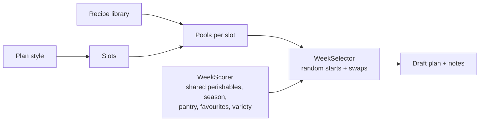

# The planner

This page explains how ChefBot chooses a week, and how the plan, leftovers, shopping list and pantry stay in step.

## Choosing a week

`PlanningEngine` turns a plan style into **slots**: dinners on the cooking days, leftover lunches, and any breakfasts,
snacks, sweets and drinks. For each slot it builds a **pool** of allowed recipes from the style's rules, then:

1. **Filters.** Recipes planned recently (`AvoidRepeatDays`) are left out first. Rules narrow the pools: "no beef",
   "at least 2 ready within 30 minutes", "1 fish dinner on Friday".
2. **Searches.** `WeekSelector` starts from several random weeks and improves each one swap at a time, keeping the
   best. This is fast enough for libraries of thousands of recipes.
3. **Scores whole weeks.** `WeekScorer` rates a set of recipes together, not one by one, because the point is how they
   fit: shared perishables, the season, pantry use, favourites and variety. The weights are `Planner:Weights` in
   [settings](../admin/settings.md#planner-weights).
4. **Relaxes rules it can't meet,** last rule first, and writes a note on the plan saying so.

Scoring whole weeks is what makes ChefBot reduce waste: a recipe that uses half a bunch of coriander scores better
when another recipe that week uses the other half.

## Keeping everything in step

Every change to a plan (stage, confirm, swap, move, mark cooked, replan, a pantry edit) goes through `PlanManager`,
and each one ends with **`ReconcileAsync`**, which:

1. places the leftover lunches after the dinners they come from (`MaxLeftoverDays`);
2. works out what the meals still to be cooked need, with `MealRequirements`, the only place ingredient needs come
   from;
3. rebuilds the shopping list with `ShoppingEngine`: totals, scaling to people, staples left off, pantry subtracted,
   stores assigned.

Because there's one path, the leftovers and the shopping list can't drift from the meals. Plan writes run one at a
time behind `PlanWriteLock`.

## Suggestions

`SuggestionEngine` ranks swaps for one meal by how well each recipe uses the pantry, especially food about to expire,
using the same `WeekScorer`. It also invents simple plates from what's on hand: a whole grain, a protein and a
vegetable or fruit.

## Amounts and units

Ingredient lines are parsed into amount, unit and food (`Units`, `IngredientCatalog`). Amounts are compared only
within the same unit. Converting between volume and weight would need a density for every food, which the catalog
doesn't hold.

## Where to look

| Concern | File |
|---|---|
| Slots, rules, leftovers, schedule | `Engines/PlanningEngine*.cs` |
| The search | `Engines/WeekSelector.cs` |
| The score | `Engines/WeekScorer.cs`, `Utilities/ScoreWeights.cs` |
| What meals need | `Engines/MealRequirements.cs` |
| Shopping list | `Engines/ShoppingEngine.cs` |
| Swaps | `Engines/SuggestionEngine.cs` |
| Use cases | `Managers/PlanManager*.cs` |

Tests: `WeekPlannerTests`, `ShoppingTests` and others in
[`tests/ChefBot.Core.Tests`](https://github.com/Jamiethenextkevinbaconhamm/chef-bot/blob/main/tests/ChefBot.Core.Tests).
