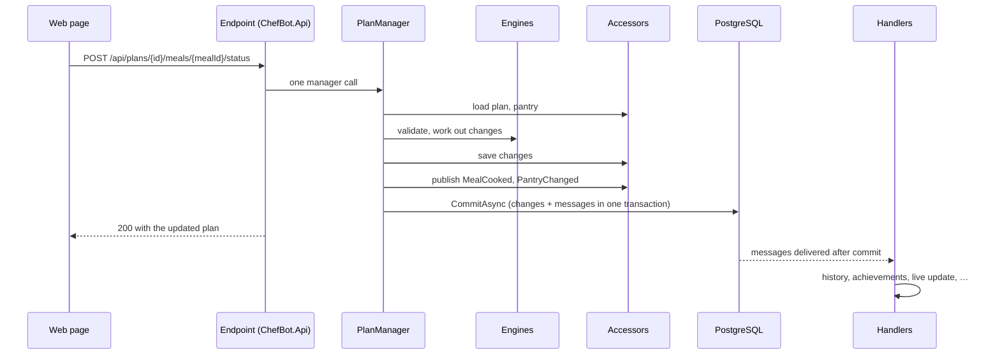

# Request lifecycle

This page follows one request, marking a meal cooked, from the browser to the database and out again.

## Step by step

1. **The endpoint** in `ChefBot.Api/Endpoints/` binds the request, calls **one** manager method and returns what it gives
   back. Admin-only endpoints carry `[Authorize(Policy = Sessions.AdminPolicy)]`. The core never checks roles.
2. **The manager** loads what it needs through accessors, hands it to engines, saves through accessors, publishes the
   events that describe what happened, and commits once through `IMessageAccess.CommitAsync`.
3. **The commit** writes the changes and the outgoing messages in the same database transaction (Wolverine's outbox), so
   an event is never sent for a change that didn't save, and never lost for one that did.
4. **The response** is a record from `Managers/Contracts/Messages/`, written by the source-generated
   `ContractJsonContext`.
5. **Handlers** in `ChefBot.Api/Messaging/` pick the messages up afterwards, each on its own queue. See
   [Messaging and scheduling](messaging-and-scheduling.md).

## Errors

Managers and engines throw the exceptions in `Managers/Contracts/`. `ChefBotExceptionHandler` turns them into
[problem details](https://www.rfc-editor.org/rfc/rfc9457):

| Exception | Status |
|---|---|
| `RuleViolationException` | 400 |
| `NotSignedInException` | 401 |
| `NotAllowedException` | 403 |
| `NotFoundException` | 404 |
| `ConflictException` | 409 |
| `RecipeSourceException` | 502 |

The `detail` is a plain sentence for the person using ChefBot: what happened and what to do next.

## MCP

MCP tools in `ChefBot.Api/Mcp/` work like endpoints: each one calls one manager method. They authenticate with API
tokens instead of the session cookie.

## Adding one

Follow the `add-core-operation` checklist in
[`.claude/skills/add-core-operation/SKILL.md`](https://github.com/Jamiethenextkevinbaconhamm/chef-bot/blob/main/.claude/skills/add-core-operation/SKILL.md). It covers the manager
method, records, JSON context, endpoint, tests and docs.
